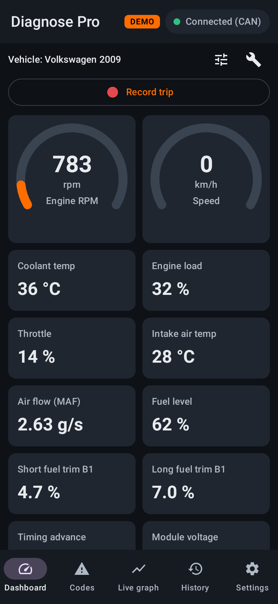
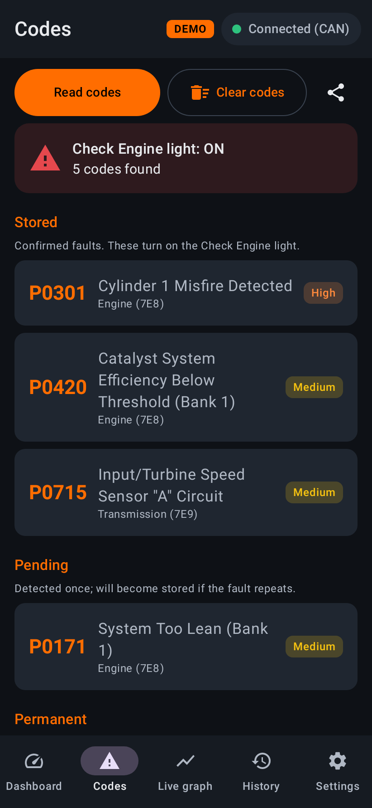
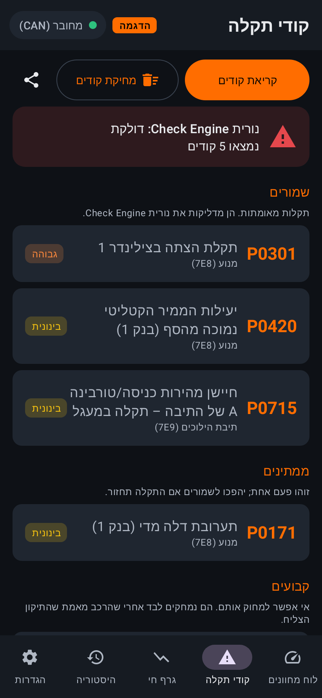
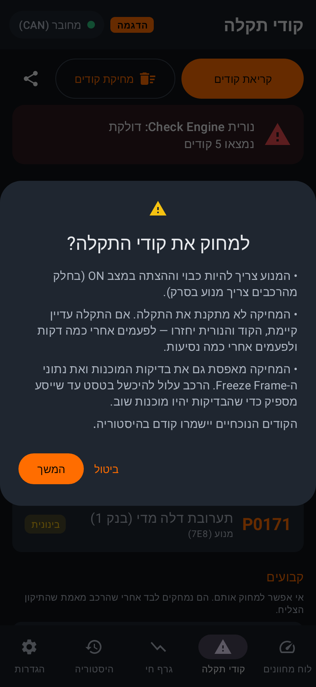

# Diagnose Pro (דיאגנוז פרו)

Free OBD2 car diagnostics for Android. No subscription, ads or accounts. The app never contacts the internet;
network permission is used only to reach Wi-Fi adapters on their own local network.
It connects to an ELM327-compatible adapter (Bluetooth Classic, Bluetooth LE or Wi-Fi), reads live engine data and fault codes, and
can clear codes to turn off the Check Engine light. Full Hebrew and English support (RTL/LTR).

> Hebrew instructions: [README.he.md](README.he.md)

| Dashboard | Codes | Code detail (HE) | Clear dialog (HE) |
|---|---|---|---|
|  |  |  |  |

## Install the APK on your phone

Two APKs are in `release/`:
- `DiagnosePro-release.apk` (recommended): signed release build, shrunk with R8 (~2.5 MB).
- `DiagnosePro-debug.apk`: debug build (~19 MB).

They are signed with different keys, so **uninstall one before installing the other** (Android refuses to
install over an app signed with a different key).

1. Copy the APK to the phone, or download it on the phone itself.
2. Open it. Android asks you to allow **Install unknown apps** for the app you opened it with
   (Files, Chrome, etc.). Allow it, go back and tap **Install**.
3. Play Protect may warn about an unknown developer: tap **More details → Install anyway**.
   (The APK is signed with a debug key.)
4. Needs Android 8.0 (API 26) or newer.

## Pair the adapter

1. Plug the ELM327 into the OBD2 port under the steering wheel and turn the ignition **ON** (or start the engine).
2. **Bluetooth Classic adapters** (most cheap ones): phone Settings → Bluetooth → pair the device
   (named OBDII / ELM327 / V-LINK…). The PIN is usually `1234` or `0000`.
3. **BLE adapters** (Vgate iCar Pro BLE, Veepeak BLE, OBDLink CX…): no pairing. Use **Scan** in the app.
4. In the app, tap the connection status at the top-right (top-left in Hebrew), allow the
   Bluetooth permission, and pick your adapter. OBD-looking devices are highlighted.

5. **Wi-Fi adapters:** connect the phone to the adapter's Wi-Fi network first, then use the **Wi-Fi adapter**
   card (default `192.168.0.10:35000`).
6. **Adapter not found by the scan?** Use **Adapter not in the list?** to enter its Bluetooth address, or
   **Try as Bluetooth LE / Classic** on a device that was detected as the wrong kind.

### Adapter compatibility

Any adapter that speaks the open **ELM327 AT command set** should work. None of these has been tested on real
hardware yet; this is what the code supports.

| Adapter family | Connection | Notes |
|---|---|---|
| Generic ELM327 (v1.5 / v2.1 clones) | Bluetooth Classic, Wi-Fi | Most common. Basics usually work; use Polling speed → Slow if unstable |
| Vgate iCar Pro / iCar 2 / iCar Pro 2S | Classic, BLE, Wi-Fi | BLE services `18F0` and the Vgate 128-bit service are recognised |
| Vgate vLinker MC / MC+ / FD / FD+ / FS / MS | Classic, BLE | BLE service `18F0` |
| OBDLink MX+ / LX / CX (STN chips) | Classic, BLE | ELM327-compatible; BLE service `FFF0` |
| Veepeak OBDCheck BLE / BLE+ / VP01 (Wi-Fi) | BLE, Wi-Fi | `FFF0` |
| LELink, Carista, Viecar, Konnwei KW902, Panlong, BAFX | BLE / Classic | `FFE0`, `FFF0`, Nordic UART or Microchip UART; unknown layouts are auto-detected |

**Not supported:** adapters with a closed, proprietary protocol such as Launch EasyDiag / X431 / ThinkDiag,
Carly, OBDeleven, BlueDriver and FIXD. They do not accept ELM327 commands and only work with their own apps.
USB adapters are not supported either.

No adapter? Choose **Demo mode** to try every screen with a simulated car.

## Features

| Feature | Where |
|---|---|
| Live gauges (RPM, speed, temps, load, MAF, MAP, fuel trims, O2, timing, voltage, run time…), only PIDs your car supports, warning colors, per-vehicle selection/order | Dashboard → *Choose gauges* |
| Read stored / pending / permanent codes, MIL status, which ECU reported each code | Codes → *Read codes* |
| Code details in Hebrew/English: description, likely causes, severity, what to check; web search for manufacturer codes | tap a code |
| **Clear codes (Mode 04)** with two confirmations; codes saved to history first; re-check after clearing | Codes → *Clear codes* |
| Share a report as text or PDF | Codes → share icon |
| Freeze frame, readiness monitors ("Ready for inspection"), vehicle info + offline VIN decoding, Mode 06, fuel consumption estimate, 0-100 km/h timer | Dashboard → wrench icon (Tools) |
| Live graph of 1-4 values: pause, zoom, CSV export | Live graph |
| Trip recording with summary, replay and CSV export; scan history with comparison against the previous scan | Dashboard → *Record trip*, History |
| Language (Hebrew / English / system), units, polling speed, auto-connect, keep screen on, theme, developer console | Settings |

**Added in 1.1** (all under Dashboard → Tools):

| Feature | Notes |
|---|---|
| ~25 more sensors + calculated ones | fuel rail pressure, EGR, catalyst temperature, lambda, pedal, torque…; turbo boost, power and instant consumption are estimates |
| All sensors | every supported value on one screen with min/max |
| Custom PIDs | your own read command (modes 01, 21, 22 only) with a formula over bytes A..H, e.g. `(A*256+B)/4` |
| Alarms | sound + banner when a value goes above/below your limit (default: coolant > 110 °C) |
| HUD mode | large speed/RPM, mirrored for windshield reflection |
| Performance tests | 0-60, 0-100, 80-120 km/h, quarter mile, braking 100-0, peak power estimate |
| Battery test | resting, cranking and charging voltage with a verdict |
| Code lookup | offline search of all fault codes by code or keyword |
| Maintenance log | service history with odometer reminders |
| Fuel cost | set price per litre in Settings; trip cost in Fuel consumption |
| Terminal | in the developer console; only adapter commands and read-only OBD services are accepted |

**Added in 1.3:**

| Feature | Notes |
|---|---|
| Full system scan | CAN cars. Finds every module that answers standard UDS on the OBD connector's bus (engine, ABS, airbag, body…) and reads its fault codes with status (current / pending). Read-only: sends only `10 01` and `19 02` |
| Module details | Standard identification per module: system name, part number, serial, software/hardware version, VIN |
| Module live data | A custom PID can target a module address found by the scan (e.g. `7B0`), so manufacturer data ids can be graphed and logged |
| Adapter / ECU status | Separate "adapter connection" and "car computer connection" lines on the connection screen |

Limits of the scan: an ELM327 is wired to one CAN bus, so modules on other buses (reached by multiplexing tools
such as Launch) are not visible. Module names are a best guess (standardized only for 29-bit CAN), and the fault
codes of these modules are manufacturer-specific.

Not included: service functions (resets, adaptations, coding) and ready-made manufacturer live-data lists. These need each
manufacturer's proprietary data and write to the car's computers.

The raw ELM327 log (copy/share) is in Tools once **Settings → Developer console** is on.

**Limits:** generic OBD2 reads the engine/emissions systems only. ABS, airbags and transmission usually need
brand-specific tools. The app is read-only except Mode 04. It never writes, codes or tunes ECUs.
Don't use the app while driving.

## Build from source

Requirements: JDK 17+ and the Android SDK (platform 34, build-tools 34).

```bat
:: Windows
set ANDROID_HOME=%LOCALAPPDATA%\Android\Sdk
gradlew.bat assembleDebug
gradlew.bat testDebugUnitTest
```
```sh
# Linux / macOS
echo "sdk.dir=$ANDROID_HOME" > local.properties
./gradlew assembleDebug testDebugUnitTest
```
Output: `app/build/outputs/apk/debug/app-debug.apk`.

### Release build

```sh
./gradlew assembleRelease   # -> app/build/outputs/apk/release/app-release.apk
```
Signing is read from `keystore.properties` in the project root (git-ignored):
```properties
storeFile=keystore/diagnosepro-release.jks
storePassword=...
keyAlias=diagnosepro
keyPassword=...
```
or from the environment variables `DP_STORE_FILE`, `DP_STORE_PASSWORD`, `DP_KEY_ALIAS`, `DP_KEY_PASSWORD`.
Without them the release APK is built unsigned. **Back up the keystore and its passwords**: every future update
must be signed with the same key, or it will not install over the existing app. Install with `adb install -r app/build/outputs/apk/debug/app-debug.apk`.

## Project layout

```
app/src/main/java/com/diagnosepro/app/
  transport/  ObdTransport + Classic SPP, BLE (auto-detects GATT chars), Demo simulator, BT helper
  elm327/     response parser, ISO-TP/multi-ECU frame assembly, command queue, init, clone detection
  obd/        data-driven PID table, decoders (DTC, monitors, Mode 02/06/09), VIN decoder, ObdService
  data/       Room (vehicles, scans, trips, samples), DataStore settings, offline DTC DB, raw log
  domain/     ObdManager (connect, auto-reconnect, smart polling, logging), clear-codes flow, units
  service/    foreground service (keeps the link alive with the screen off)
  i18n/       per-app language, bidi isolation for codes/numbers
  ui/         Compose screens, components (gauges, charts), navigation
app/src/main/assets/dtc_db.json   2,064 generic codes, EN+HE (generator: tools/dtc/generate_dtc_db.py)
```

## Tests

`gradlew testDebugUnitTest` runs 70+ JVM tests: PID formulas, DTC decoding (CAN single/multi-frame,
headers on/off, 11/29-bit, J1850/ISO 9141 multi-ECU), ELM327 parser against recorded responses, VIN decoder,
clear-codes flow (success / codes come back / NO DATA / negative response), units, DTC database, string
parity EN/HE (fails if a Hebrew string is missing), and a **full UI run of the real app in demo mode in both
English and Hebrew** (Robolectric), which saves screenshots to `app/build/screenshots/`.
